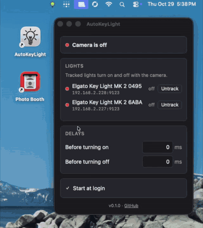

# AutoKeyLight

Turns your Elgato lights on and off when your webcam turns on and off.



A cross-platform Rust and [Tauri](https://tauri.app) rewrite of [AutoKeyLight](https://github.com/astutejoe/AutoKeyLight)
by [Gabriel Garcia (@astutejoe)](https://github.com/astutejoe), the original Windows app, MIT licensed. Thanks Gabriel!

## Features

- Lives in the tray (menu bar on macOS), click the icon for settings
- Finds your lights on the network automatically, no IP addresses to enter
- Lights switch only when the camera turns on or off, so lights you switch yourself stay that way
- **Track** or **Untrack** each light, optional delays before turning lights on or off, start at login
- Event driven, does nothing in the background until the camera changes

## Install

Download the installer from the [releases](https://github.com/tdakhran/AutoKeyLight-rs/releases).

- **Windows:** run `AutoKeyLight_<version>_x64-setup.exe`, no administrator rights needed. Allow it on private
  networks when Windows Firewall asks. Uninstall from **Settings** → **Apps**.
- **macOS (Apple silicon):** open the `.dmg` and drag AutoKeyLight into Applications. The app isn't signed, so open it
  the first time with right click → **Open**, and click **Allow** when it asks to find devices on your local network.
  Uninstall by turning off start at login, then moving the app to the Trash.

If no lights show up, check the firewall (Windows) or **System Settings** → **Privacy & Security** → **Local Network**
(macOS).

## Platform support

| | Camera detection | Tested on |
|---|---|---|
| Windows | ✅ Media Foundation [sensor activity monitor](https://learn.microsoft.com/en-us/windows/win32/api/mfidl/nn-mfidl-imfsensoractivitymonitor) | Windows 11 26300 |
| macOS | ✅ [CoreMediaIO](https://developer.apple.com/documentation/coremediaio) | macOS 26.4, Apple silicon |
| Linux | Not yet | |


## Build

Install [Rust](https://rustup.rs) and the [Tauri prerequisites](https://tauri.app/start/prerequisites/), then:

```sh
cargo install tauri-cli --version "^2"
cargo tauri build
```

Installers end up in `target/release/bundle/`: a setup `.exe` on Windows, an `.app` and `.dmg` on macOS. Debug builds
(`cargo build`) write a timing log to `autokeylight.log` in the temp directory.

The version comes from `Cargo.toml`. [GitHub Actions](.github/workflows/build.yml) builds both installers on every
push, and pushing a matching tag like `v0.2.0` creates a draft release with them.

## License

MIT, see [LICENSE](LICENSE), which includes the copyright notice of the original AutoKeyLight project.
